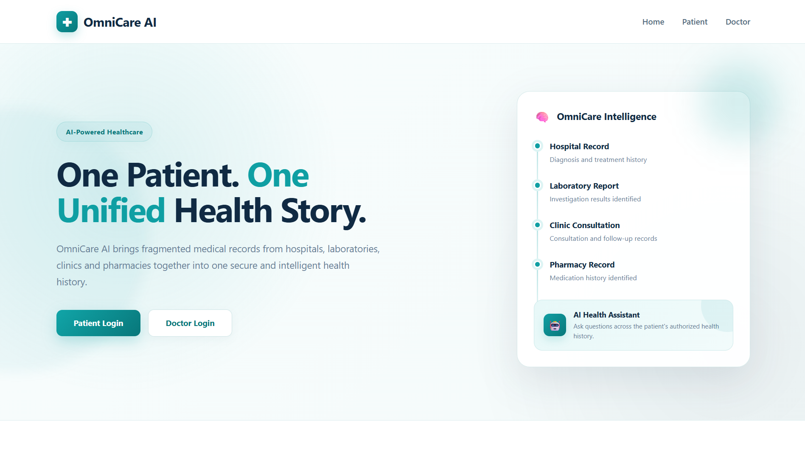
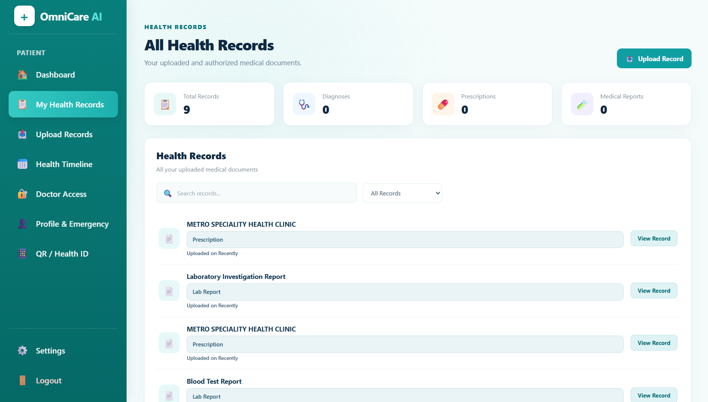
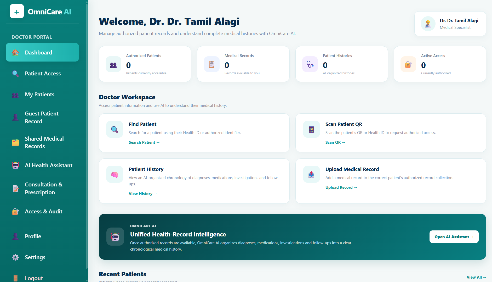
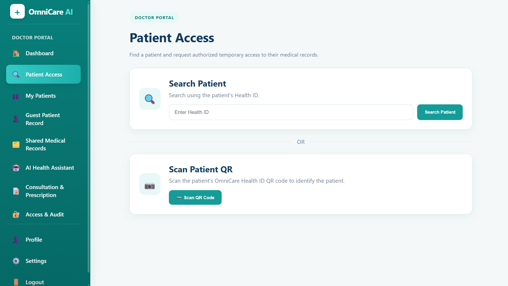
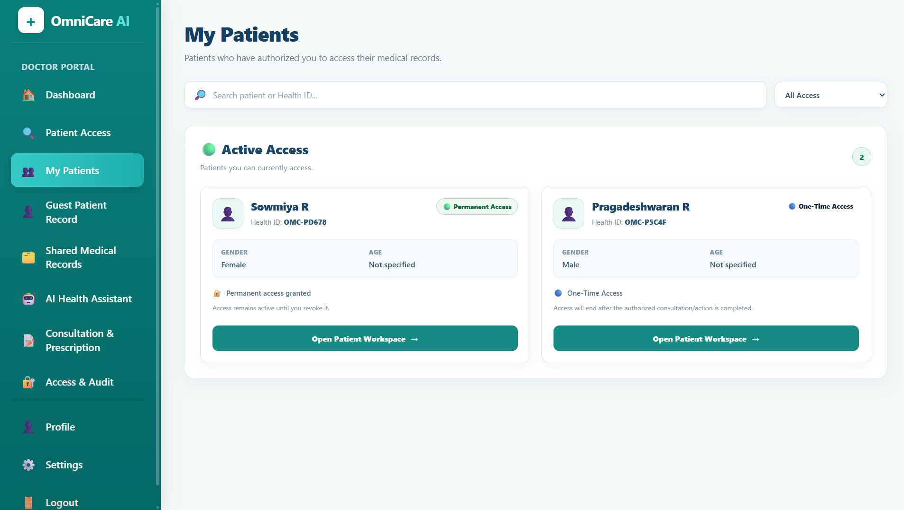

# 🏥 OmniCare AI
### AI-Powered Unified Medical Record Intelligence Platform

OmniCare AI is a healthcare web application designed to address the problem of **scattered patient medical histories**. It aims to organize medical information from different records into a unified workspace, helping doctors review patient histories, understand clinical timelines, and identify potential issues through evidence-based analysis and AI-assisted summarization.

> **Project Status:** Under active development.

---

## 📸 Application Screenshots

### 1. Home Page


### 2. Patient Dashboard


### 3. Doctor Dashboard


### 4. Clinical Copilot


### 5. Guest Patient Workspace


---

## 🎯 Problem Statement

Patient medical histories are often scattered across hospitals, laboratories, prescriptions, investigation reports, and physical documents. This makes it difficult for healthcare professionals to access a consolidated view of a patient's medical history.

**OmniCare AI aims to solve this problem** by organizing available medical records, maintaining chronological health information, and supporting authorized clinical review through intelligent record processing.

## ✨ Key Features

### 👨‍⚕️ Doctor Portal
- Doctor dashboard and patient management.
- Patient search and authorized medical record access.
- Medical history and investigation report review.
- Prescription-related workflows.
- Guest patient workspace.
- Access and audit history, where implemented.

### 🧑 Patient Workspace
- Patient dashboard and health overview.
- Medical record uploads.
- Health timeline and medical history.
- Prescription and laboratory report access.
- Doctor access and consent workflows.
- Profile and emergency information.
- QR or Health ID functionality, where configured.

### 🧠 Medical Record Intelligence
- Extraction of structured information from supported medical documents.
- Medical record normalization and validation.
- Chronological medical history organization.
- Evidence-linked clinical summaries.
- Detection of potentially conflicting or inconsistent information.
- Analysis of available health measurements.

### 🤖 Clinical Copilot
- Doctor-focused clinical briefing.
- Natural-language queries about authorized patient records.
- Cross-patient analysis subject to authorization and consent.
- Trend analysis based on available measurements.
- Potential medication and data-conflict alerts.
- Evidence references and limitations in clinical summaries.

*Feature availability depends on the current implementation, backend integration, and configuration.*

### 🔐 Security and Privacy
- Authentication and role-based access.
- Patient-specific record ownership.
- Consent-aware access workflows.
- Server-side authorization checks.
- Environment-based configuration for secrets.
- Audit logging for sensitive operations, where implemented.

---

## 🛠️ Technology Stack

| Component | Technology |
|---|---|
| Backend | Python, Flask |
| Frontend | HTML, CSS, JavaScript, Jinja2 |
| Database | Supabase |
| AI integration | Google Gemini API |
| Document processing | Python-based processing |
| Version control | Git, GitHub |

Additional libraries depend on the project's current dependencies.

## 🏗️ System Architecture

```text
Patient / Doctor
       |
       v
Flask Web Application
       |
       +---- Patient Workspace
       |
       +---- Doctor Portal
       |
       +---- Guest Patient Workspace
       |
       +---- Clinical Copilot
                    |
                    v
          Medical Intelligence Layer
                    |
          +---------+---------+
          |         |         |
       Normalize  Rules    Evidence
          |       Engine   Retrieval
          |         |         |
          +---------+---------+
                    |
                    v
                 Supabase
                    |
                    v
       Authorized Medical Information
                    |
                    v
       Optional AI-Assisted Summaries
```

## 📁 Project Structure

```text
OmniCare-AI/
├── app.py
├── services/
├── utils/
├── templates/
├── static/
│   ├── css/
│   ├── js/
│   └── images/
├── screenshots/
│   ├── home-page.png
│   ├── patient-dashboard.png
│   ├── doctor-dashboard.png
│   ├── clinical-copilot.png
│   └── guest-patient-workspace.png
├── tests/
├── requirements.txt
├── .env.example
├── .gitignore
└── README.md
```

*This is a representative structure. Your actual project may contain additional files or different names.*

## 🚀 Installation and Setup

### Prerequisites

- Python 3.10 or a compatible version supported by the project's dependencies.
- Git.
- A configured Supabase project.
- A Gemini API key if AI-powered features are enabled.

### 1. Clone the repository

```bash
git clone https://github.com/Pragadeshwaran05/OmniCare-AI.git
cd OmniCare-AI
```

### 2. Create a virtual environment

**Windows PowerShell:**

```powershell
python -m venv .venv
.\.venv\Scripts\Activate.ps1
```

### 3. Install dependencies

```bash
python -m pip install --upgrade pip
pip install -r requirements.txt
```

### 4. Configure environment variables

Create a local `.env` file in the project root using the variable names expected by your application.

Example:

```env
SECRET_KEY=your_secure_secret
SUPABASE_URL=https://your-project.supabase.co
SUPABASE_KEY=your_supabase_key
GEMINI_API_KEY=your_gemini_api_key
```

These are example variable names. Verify the actual configuration in your source code.

**Important:** Never commit `.env`, API keys, database credentials, or real patient medical records to GitHub.

### 5. Configure Supabase

Set up the database tables, authentication, access policies, and storage required by the application.

Use the actual schema and migrations in your project. Ensure patient records are associated with the correct patient identifier and that unauthorized access is denied.

### 6. Run the application

```bash
python app.py
```

Open the local URL displayed in the terminal. With the default Flask development configuration, this is commonly:

`http://127.0.0.1:5000/`

## ☁️ Deployment

OmniCare AI can be deployed to a compatible Python hosting platform, such as Render.

Typical Render configuration:

- **Build command:** `pip install -r requirements.txt`
- **Start command:** `gunicorn app:app`

These commands assume `requirements.txt` exists and the Flask application instance is named `app` in `app.py`.

Configure environment variables through the hosting platform's settings. Test authentication, database access, patient isolation, and AI integrations before sharing a public demo link.

## 🧪 Testing

If the project uses pytest, run:

```bash
python -m pytest -v
```

Test authentication, consent enforcement, patient data isolation, document processing, clinical rules, evidence references, and AI failure handling.

Use synthetic data for testing and demonstrations.

## 🔒 Medical Safety and Privacy

OmniCare AI is intended to support medical information management and clinical review. It does not replace professional medical judgment.

- Clinical findings should be traceable to source records.
- Missing or uncertain information should be identified.
- Potential medication conflicts require appropriate clinical review.
- AI-generated summaries must not be treated as verified diagnoses.
- Patient information must remain isolated and accessible only to authorized users.

Production use requires appropriate security, privacy, clinical validation, and operational review.

## 🚧 Future Enhancements

Potential areas for continued development include:

- Improved medical document extraction.
- Broader medical record interoperability.
- More comprehensive clinical rules and evidence retrieval.
- Validated medication interaction checking.
- Enhanced audit reporting.
- Automated testing and production monitoring.
- Deployment and performance optimization.

## 👨‍💻 Author

**R. Pragadeshwaran**

Computer Science and Engineering | Web Development | Machine Learning

GitHub: [Pragadeshwaran05](https://github.com/Pragadeshwaran05)

## 📄 License

Add a license file if you intend to distribute the project under a specific open-source license.
